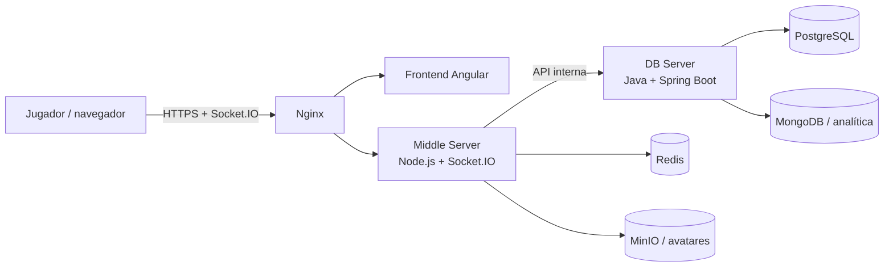

<div align="center">

# ⚔️ Viking Clan Wars

### La guerra se juega en tiempo real.

**Proyecto intermodular · Estrategia multijugador · Arquitectura distribuida**

[](https://angular.dev/)
[](https://nodejs.org/)
[](https://openjdk.org/)
[](https://docs.docker.com/compose/)

[Arquitectura](#-arquitectura) · [Puesta en marcha](#-puesta-en-marcha) · [Servicios](#-servicios-y-puertos) · [Repositorios](#-repositorios-del-proyecto)

</div>

---

## 🛡️ El proyecto

**Viking Clan Wars** es un juego de estrategia multijugador en tiempo real para **2–6 jugadores**. Cada jugador lidera un clan, administra recursos, investiga tecnologías y despliega tropas en una guerra persistente.

Este repositorio es el **orquestador**: reúne los servicios, configura la infraestructura con Docker Compose y proporciona scripts para clonar los proyectos dependientes.

## 🧭 Arquitectura



| Componente | Responsabilidad | Tecnología |
|---|---|---|
| **Frontend** | Interfaz, lobby y experiencia de juego | Angular 20, TypeScript, Socket.IO Client |
| **Middle Server** | Motor autoritativo, API y comunicación en tiempo real | Node.js 22, Express, Socket.IO |
| **DB Server** | Persistencia y API interna | Java 25, Spring Boot, PostgreSQL, MongoDB |
| **Infraestructura** | Proxy, caché, almacenamiento de avatares y bases de datos | Nginx, Redis, MinIO, Docker Compose |

## 🧩 Repositorios del proyecto

| Repositorio | Qué encontrarás |
|---|---|
| [Orquestador — `tfm`](https://github.com/agb4455/tfm) | Compose, Nginx y scripts de preparación (este repositorio). |
| [Frontend](https://github.com/agb4455/ProyectoIntermodularDamFrontend) | Aplicación web Angular y PWA. |
| [Middle Server](https://github.com/agb4455/ProyectoIntermodularDamServidorIntermedio) | Motor de juego, API HTTP y eventos Socket.IO. |
| [DB Server](https://github.com/agb4455/ProyectoIntermodularDamBackend) | Persistencia, migraciones y analítica. |

## 🚀 Puesta en marcha

### Requisitos

- Git
- Docker Engine y Docker Compose v2
- Para desarrollo fuera de contenedores: Node.js 22 y Java 25

### 1. Clonar el orquestador y preparar los servicios

```bash
git clone https://github.com/agb4455/tfm.git
cd tfm
```

En Linux/macOS, el script clona los tres repositorios dependientes en `front/`, `middle_server/` y `db_back/`, e instala las dependencias Node:

```bash
./prepareEnviroment.sh
```

En Windows puedes usar `prepareEnviroment.ps1` o `prepareEnviroment.bat`. Hace falta tener Git, Node.js y npm disponibles en el `PATH`.

### 2. Configurar secretos

Crea un archivo `.env` en la raíz. Compose lee este archivo automáticamente. Como mínimo, define secretos propios para:

```dotenv
JWT_SECRET=pon-aqui-un-secreto-largo-y-aleatorio
DB_HANDSHAKE_SECRET=pon-aqui-otro-secreto-largo-y-aleatorio
```

Los Compose incluyen valores de conveniencia para desarrollo en algunas dependencias, pero **no uses credenciales de ejemplo ni secretos de desarrollo en un despliegue público**. Revisa las variables que utiliza el Compose elegido y reemplaza los valores de ejemplo.

### 3. Arrancar el entorno

**Desarrollo** — monta los proyectos locales y arranca Angular, Node y Java con sus comandos de desarrollo:

```bash
docker compose -f docker-compose.dev.yml up --build
```

**Producción local** — construye las imágenes desde los clones locales:

```bash
docker compose up --build -d
```

Para seguir los logs o detener los contenedores:

```bash
docker compose -f docker-compose.dev.yml logs -f
# Ctrl+C detiene la salida; para parar los servicios:
docker compose -f docker-compose.dev.yml down
```

> El Compose de desarrollo expone los puertos de depuración de las bases de datos en `127.0.0.1`. No lo publiques directamente en Internet.

## 🌐 Servicios y puertos

| Entorno | Servicio | Dirección desde el host |
|---|---|---|
| Desarrollo | Frontend Angular | [http://localhost:4200](http://localhost:4200) |
| Desarrollo | API / Socket.IO | [http://localhost:3000](http://localhost:3000) |
| Desarrollo | DB Server | [http://localhost:8080](http://localhost:8080) |
| Desarrollo | PostgreSQL | `localhost:5432` (solo local) |
| Desarrollo | MongoDB | `localhost:27017` (solo local) |
| Desarrollo | Redis | `localhost:6379` (solo local) |
| Ambos | MinIO API / consola | [http://localhost:9000](http://localhost:9000) / [http://localhost:9001](http://localhost:9001) |
| Producción local | Aplicación vía Nginx | [http://localhost](http://localhost) / [https://localhost](https://localhost) |

En el Compose de producción, Nginx es la entrada pública; los puertos internos de la API y las bases de datos no se publican al host. Para HTTPS real, configura un dominio y certificados válidos.

## 🗂️ Estructura

```text
tfm/
├── docker-compose.yml          # Construcción con los repositorios locales
├── docker-compose.dev.yml      # Desarrollo con hot reload
├── docker-compose.gh.yml       # Despliegue con imágenes de GHCR
├── nginx/                      # Proxy inverso y configuración TLS
├── prepareEnviroment.sh        # Clonado e instalación (Linux/macOS)
├── prepareEnviroment.ps1       # Preparación (PowerShell)
├── prepareEnviroment.bat       # Preparación (Windows CMD)
├── front/                      # Clon del frontend (lo prepara el script)
├── middle_server/              # Clon del motor (lo prepara el script)
└── db_back/                    # Clon de persistencia (lo prepara el script)
```

## 🧰 Solución rápida de problemas

- **No aparece `front/`, `middle_server/` o `db_back/`:** ejecuta el script de preparación desde la raíz de este repositorio.
- **La aplicación no autentica o el middle server no arranca:** comprueba que `JWT_SECRET` y `DB_HANDSHAKE_SECRET` están definidos y coinciden entre servicios.
- **Un puerto está ocupado:** detén el proceso que lo usa o cambia el mapeo correspondiente en el Compose.
- **Quieres reiniciar los datos locales:** `docker compose down -v` elimina también los volúmenes de datos; úsalo solo si aceptas perderlos.
- **La imagen/servicio depende de otro que aún arranca:** revisa `docker compose logs -f <servicio>`; `depends_on` no garantiza que todos los servicios estén listos para aceptar conexiones.

## 👥 Equipo

- Adrián González Blanco
- Adriana Cabaleiro Álvarez

## 📄 Licencia

Consulta [`LICENSE`](./LICENSE) para las condiciones de uso del proyecto.

<div align="center">

**Reúne a tu clan. Protege tu capital. Forja tu leyenda.**

</div>
