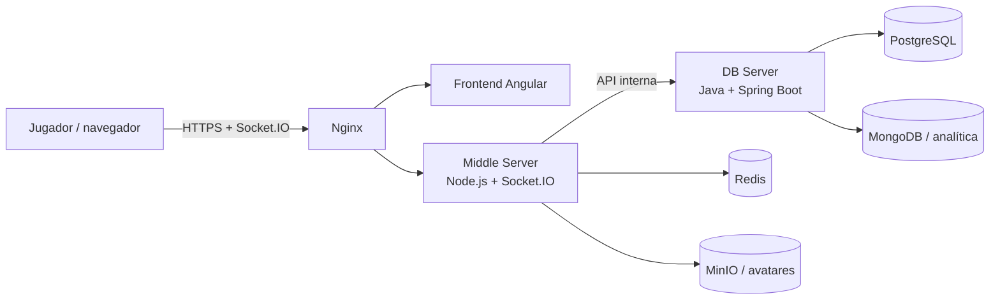

# Arquitectura del proyecto

## Visión general

Este repositorio actúa como orquestador del proyecto Viking Clan Wars. Su objetivo es coordinar los servicios principales del sistema y facilitar la puesta en marcha del entorno completo.

## Componentes principales

- Frontend: interfaz web y experiencia de juego
- Middle Server: motor del juego, lógica de negocio y comunicación en tiempo real
- DB Server: persistencia, servicios internos y acceso a datos
- Infraestructura: Nginx, Redis, MinIO, PostgreSQL, MongoDB y Docker Compose

## Topología del sistema

## Responsabilidades por repositorio

- `tfm`: orquestación del entorno, Docker Compose, scripts de preparación, proxy y documentación del proyecto
- `ProyectoIntermodularDamFrontend`: aplicación web Angular y consumo de servicios
- `ProyectoIntermodularDamServidorIntermedio`: motor del juego, comunicación en tiempo real y API HTTP
- `ProyectoIntermodularDamBackend`: persistencia, acceso a datos y servicios de negocio

## Requisitos de integración

Los repositorios deben mantener una API y un modelo de eventos compatibles entre sí. Los cambios de contrato deben coordinarse entre repos antes de fusionarse.

## Convenciones clave

- Las variables de entorno se definen en `.env` y se documentan en `.env.example`
- Los servicios que se comunican entre sí deben respetar la configuración de red y host declarada en Docker Compose
- Las decisiones de arquitectura relevantes deben documentarse en `docs/`
- Los cambios de infraestructura deben validarse con Docker Compose y con las pruebas del servicio afectado
